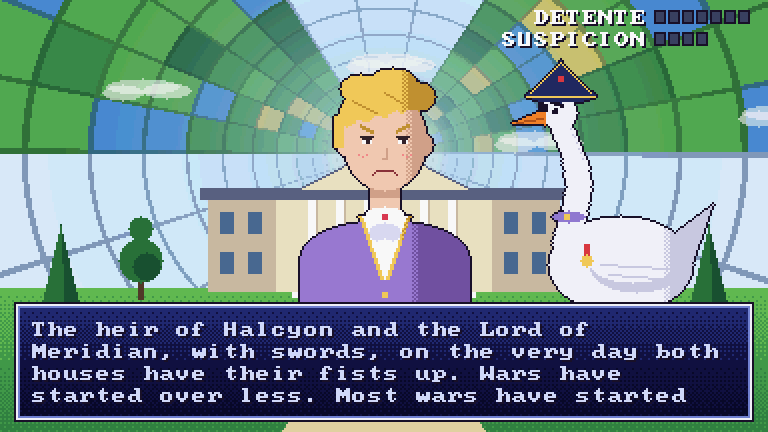

# Below Stairs, Above Stars

A 16-bit style sci-fi visual novel written in Rust.

You are Marlowe, head of household to the Honourable Peregrine Varrow, heir to
the Thistlemere estate on the O'Neill cylinder Halcyon Reach. He turns twenty
tomorrow. Lord Solberg has arrived from Meridian Spindle with forty trunks, his
own bottled air and an ultimatum, and both houses have their fists up over a
comet.

Your job is to survive the heir's Views (weightless soup, a swan with a naval
commission, a duel over the word "goose") while working with Lord Solberg's
servants to stop the war: letting the right thing be overheard by the right
lord. Tell a lord what his rival *needs* and he starts naming a price. Tell him
where his rival is *weak* and he reaches for a weapon.

Six chapters, five endings.

| | |
|---|---|
|  |  |
|  |  |

## Running

```bash
cargo run --release
```

Requires a Rust toolchain. On Linux the window uses X11 (`libx11-dev` or your
distribution's equivalent); Windows and macOS need nothing extra.

`--scale N` sets the window size (1-6, default 3; the game renders at 384x216).

## Controls

| Key | Action |
|---|---|
| Enter / Space / Z / left click | advance text, confirm |
| Up / Down (or W / S), mouse | pick a choice |
| Ctrl (hold) | skip text |
| F5 / F9 | save / load (one slot, `below_stairs.sav`) |
| Esc | back to title; quit from title |

The two meters top right are **Detente** (how close the lords are to a deal)
and **Suspicion** (how close you are to the algae vats).

## How it is built

- `src/gfx.rs` - software renderer: canvas, primitives, ordered dithering,
  8x8 bitmap font, 15-bit colour quantisation.
- `src/art.rs` - all artwork, drawn procedurally in code: seven backgrounds
  and seven characters with six expressions each. There are no image files.
- `src/script.rs` - parser and virtual machine for the story script.
- `src/game.rs` - title screen, dialogue, choices, HUD, save/load.
- `assets/story.txt` - the whole story, in a small line-based script language
  documented at the top of the file. Edit it and rebuild to change the game.

## Testing

```bash
cargo test
```

The tests validate every label, speaker, sprite and background referenced by
the story, then play every possible combination of choices to check that each
one reaches an ending and that all five endings are reachable.

A playthrough can also be run with no window, choosing the listed option at
each choice and writing screenshots:

```bash
cargo run --release -- --autoplay 0,0,1,0,0,2,3 --shots shots
```
