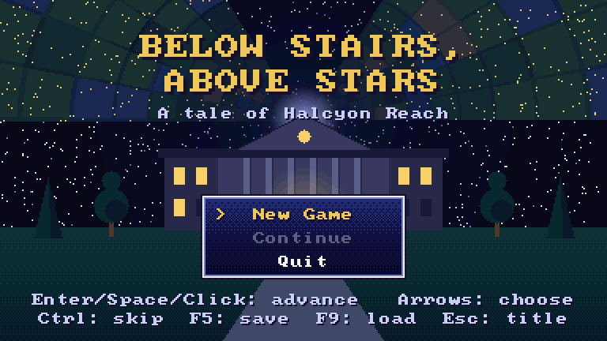
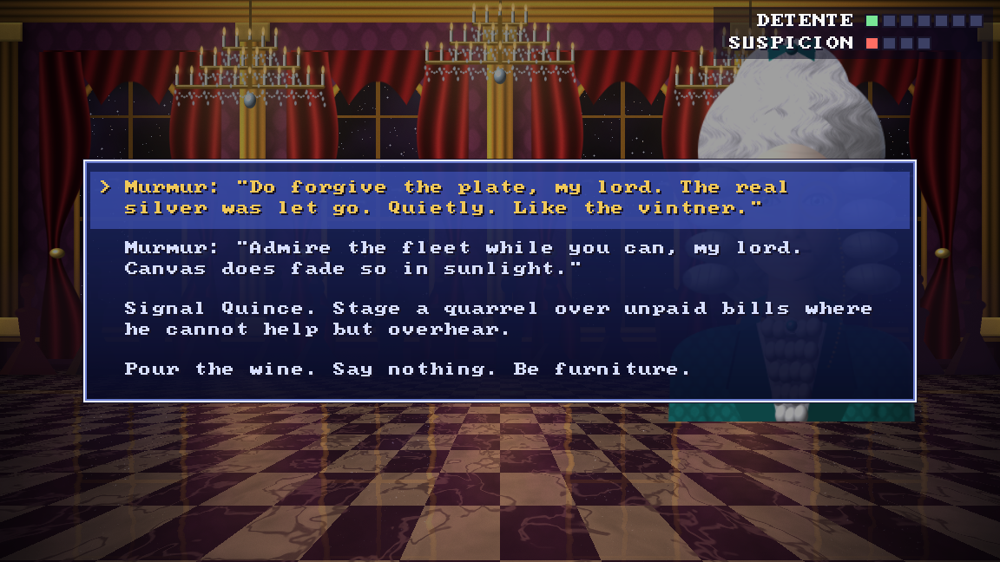

# Below Stairs, Above Stars

A sci-fi visual novel written in Rust, with every image painted in code.

You are Marlowe, head of household to the Honourable Peregrine Varrow, heir to
the Thistlemere estate on the O'Neill cylinder Halcyon Reach. He turns twenty
tomorrow. Lord Solberg has arrived from Meridian Spindle with forty trunks, his
own bottled air and an ultimatum, and both houses have their fists up over a
comet.

Your job is to survive the heir's Views (weightless soup, a swan with a naval
commission, a duel over the word "goose") while working with Lord Solberg's
servants to stop the war: letting the right thing be overheard by the right
lord. Tell a lord what his rival *needs* and he starts naming a price. Tell him
where his rival is *weak* and he reaches for a weapon.

Six chapters, five endings.

| | |
|---|---|
|  |  |
|  |  |
|  |  |

## Running

```bash
cargo run --release
```

Requires a Rust toolchain. On Linux the window uses X11 (`libx11-dev` or your
distribution's equivalent); Windows and macOS need nothing extra.

The game renders at 1152x648. The window is resizable; `--window 800x450`
sets its starting size.

## Controls

| Key | Action |
|---|---|
| Enter / Space / Z / left click | advance text, confirm |
| Up / Down (or W / S), mouse | pick a choice |
| Ctrl (hold) | skip text |
| F5 / F9 | save / load (one slot, `below_stairs.sav`) |
| Esc | back to title; quit from title |

The two meters top right are **Detente** (how close the lords are to a deal)
and **Suspicion** (how close you are to the algae vats).

## Story editor

```bash
cargo run --release -- --editor
```

opens a visual editor for the story in your browser (it prints the address,
`http://127.0.0.1:7878/`, if no browser opens). It edits `assets/story.txt`
directly; the game reads that file each time it starts, so there is nothing
to rebuild.


- **The graph** shows every scene as a box. Gold lines are choices, blue are
  conditions, grey are jumps, and a dashed line means the scene simply
  continues into the next one. Drag scenes to arrange them; drag the round
  port at the end of a choice, condition or jump on to another scene to
  change where it leads, or on to empty space to make a new scene.
- **Consequences** are changes to a property (Detente +2, Suspicion +1).
  They appear as chips on the scene they happen in and beside every choice
  that leads there.
- **The panel on the right** edits the selected scene: its lines, choices,
  consequences, conditions, backgrounds and who is on screen. Drag a block by
  its grip to reorder it, or drop it on another scene in the graph to move it
  there.
- **Cast** holds each character's name, name colour, portrait and look (hair,
  skin, coat, age and so on, with a live preview), and the properties that
  belong to them. **Properties** lists every property, its starting value,
  whether it has an on-screen meter, and everywhere it is changed or tested.
  **Scenes** lists scenes in file order; drag to reorder.
- Problems are checked as you type by the same validator the game uses.
  **Play** and **Play from here** save and launch the game at that scene.
- Undo and redo work on everything; the first save of a session keeps the
  previous file as `story.txt.bak`.

### Several stories

The menu at the top of the editor switches between stories and makes,
duplicates or removes them. Every story is independent: its own file, cast,
properties and art.

- The main story is `assets/story.txt`. Others live in
  `stories/<name>/story.txt`.
- A story's title and subtitle (Scenes tab) appear on the game's title screen.
- Removing a story moves its folder to `stories/.removed/`; nothing is deleted.
- To play one: `cargo run --release -- --story stories/<name>/story.txt`, or
  use Play in the editor.

### Art: sending assets through ComfyUI

The **Art** button opens a view of every background and every character
expression in the current story, and sends any of them through ComfyUI.


- Set the ComfyUI address at the top; the checkpoint and ControlNet lists are
  read from that server.
- Pick a workflow for backgrounds, for neutral portraits and for expressions,
  or send a single image "through" another workflow once. Six come built in:

  | Workflow | For | What it does |
  |---|---|---|
  | Faithful repaint | backgrounds | img2img from the game's painting, composition held by ControlNet |
  | Reimagine | backgrounds | painted from scratch; only the painting's outlines are kept |
  | Refine | backgrounds | a light second pass over the current image, no ControlNet |
  | Faithful portrait | neutral portraits | img2img + ControlNet, cut out with the sprite's own silhouette |
  | Reimagine portrait | neutral portraits | from scratch inside the sprite's outline |
  | Expression | the other five expressions | repaints only the face of the enhanced neutral, so the character stays the same person |

- Each background and character has a text prompt you can replace; a
  character whose look you have changed in the Cast tab will want one.
- Jobs queue up and run one at a time; results appear in place, with a
  click-to-compare against the game's own painting. **Revert** goes back to
  the painting (the file is set aside in `enhanced/.removed`).
- Results are saved beside the story, in its `enhanced/` folder
  (`assets/enhanced/` for the main story), which is where the game looks.
- Workflows are the JSON files in `comfyui/workflows/`. Add your own there:
  give it a `title`, a `kind` (`background`, `sprite` or `expression`) and
  the same `$placeholders` as the built-in ones, and it appears in the menus.

No image has been generated with these workflows on a real GPU; see
[comfyui/README.md](comfyui/README.md) for what was and was not verified, and
for the command-line runner that does the same job in bulk. To try the Art
view without ComfyUI, `python3 tools/mock_comfy_server.py` runs a stand-in
that returns placeholder images.

Options: `--port N`, `--no-browser`, `--story FILE` (the main story),
`--stories DIR`, `--comfy-dir DIR`. The editor listens on your own machine
only and refuses requests from other web pages.

## Graphics

All artwork is procedural: there are no image files in the game. Each scene
is shaded per pixel with lit materials, perspective floors, soft shadows and
a small animated overlay (firelight, drifting breakfast, the hologram). The
six human characters come from one parameterised portrait renderer and have
six expressions each.

### Enhancing the art with ComfyUI

The paintings can be exported as guide images and repainted by a diffusion
model through ComfyUI, with the game's art holding the composition (img2img
plus ControlNet). See [comfyui/README.md](comfyui/README.md). In short:

```bash
python3 comfyui/enhance.py export
```

```bash
python3 comfyui/enhance.py run
```

The results go to `assets/enhanced/` as `bg_<name>.png` and
`spr_<who>_<expr>.png`. The game loads whichever of those exist in place of
its own painting (any resolution; sprites need transparency) and falls back
to the procedural version for the rest. `--procedural` ignores them,
`--art-dir DIR` or `$BELOW_STAIRS_ART` loads them from elsewhere. You can
drop hand-painted replacements there too.

## How it is built

- `src/gfx.rs` - software renderer: ARGB canvas, anti-aliased primitives,
  alpha compositing, noise, blur, resampling, PNG I/O, bitmap font.
- `src/art/` - the artwork: `paint.rs` (shading toolkit), one module per
  scene, `people.rs` and `swan.rs` for the cast, and `mod.rs` (registry,
  enhanced-art loader, guide export).
- `src/script.rs` - the story: document model (text and JSON), validator,
  compiler and virtual machine.
- `src/editor.rs`, `src/editor.html` - the story editor: a small local web
  server (story library, previews) and the page it serves.
- `src/comfy.rs` - the editor's ComfyUI client: workflow filling and
  checking, uploads, and the job queue.
- `src/game.rs` - title screen, dialogue, choices, HUD, save/load.
- `assets/story.txt` - the whole story, cast and properties, in a small
  line-based language documented at the top of the file. Edit it by hand or
  with the editor; the game reads it at start-up (`--story FILE` for another,
  `--start LABEL` to begin at a scene).
- `comfyui/` - the enhancement suite: workflows, runner, tests.

## Testing

```bash
cargo test
```

The tests validate the story, play every possible combination of choices to
check that each one reaches an ending and that all five endings are
reachable, and check that the story file survives a round trip through the
editor's formats unchanged.

The editor has a browser test (needs Node with Playwright):

```bash
cargo build && node tools/editor_e2e.js
```

```bash
cargo build && node tools/editor_art_e2e.js
```

The second covers the story library and the Art view, against a mock ComfyUI
server (also needs Python 3).

The ComfyUI suite has its own tests (no network or GPU needed):

```bash
python3 -m unittest discover comfyui/tests
```

A playthrough can also be run with no window, choosing the listed option at
each choice and writing screenshots:

```bash
cargo run --release -- --autoplay 0,0,1,0,0,2,3 --shots shots
```
