# Below Stairs, Above Stars

A sci-fi visual novel written in Rust, with every image painted in code.

You are Marlowe, head of household to the Honourable Peregrine Varrow, heir to
the Thistlemere estate on the O'Neill cylinder Halcyon Reach. He turns twenty
tomorrow. Lord Solberg has arrived from Meridian Spindle with forty trunks, his
own bottled air and an ultimatum, and both houses have their fists up over a
comet.

Your job is to survive the heir's Views (weightless soup, a swan with a naval
commission, a duel over the word "goose") while working with Lord Solberg's
servants to stop the war: letting the right thing be overheard by the right
lord. Tell a lord what his rival *needs* and he starts naming a price. Tell him
where his rival is *weak* and he reaches for a weapon.

Six chapters, five endings.

| | |
|---|---|
|  |  |
| 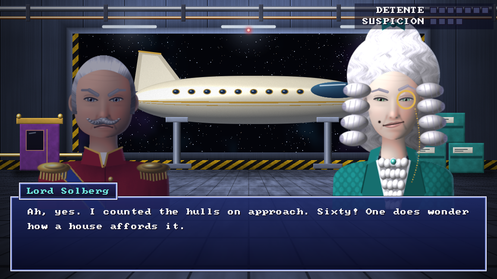 |  |
|  |  |

## Running

```bash
cargo run --release
```

Requires a Rust toolchain. On Linux the window uses X11 (`libx11-dev` or your
distribution's equivalent) and sound uses ALSA (`libasound2-dev`); Windows
and macOS need nothing extra. To build without sound, and without the ALSA
requirement: `cargo run --release --no-default-features`.

`--silent` starts the game without music or voices.

The game renders at 1152x648. The window is resizable; `--window 800x450`
sets its starting size.

## Controls

| Key | Action |
|---|---|
| Enter / Space / Z / left click | advance text, confirm |
| Up / Down (or W / S), mouse | pick a choice |
| Ctrl (hold) | skip text |
| M | sound off / on |
| I | who has what (in a story where characters have things) |
| F5 / F9 | save / load (one slot, `below_stairs.sav`) |
| Esc | back to title; quit from title |

The two meters top right are **Detente** (how close the lords are to a deal)
and **Suspicion** (how close you are to the algae vats).

## The Godot project

The game is also a [Godot 4](https://godotengine.org) project, in `godot/`.
Godot shows the story, over paintings and in 3D places, and Godot's editor
is where the pictures and places are worked on: every place is an ordinary
scene, every picture an ordinary texture.

```bash
godot --path godot              # play
godot --path godot --editor     # open in the editor
```

It needs Godot 4.3 or later. What is in the project:

| | |
|---|---|
| `places/<place>.tscn` | each 3D place as a scene: meshes with shared materials, lamps and suns, the air (a WorldEnvironment), collision for what you walk around, and markers named `Spawn`, `CastLeft`, `CastCentre`, `CastRight`. Move, restyle, replace or add anything; keep the markers. |
| `art/bg/<place>.png` | the paintings behind the story where a place is 2D. Replace a file to replace the painting. |
| `art/portraits/<who>_<expression>.png` | the cast: shown over paintings, and as cut-outs in 3D places. |
| `scenes/` | the 2D stage (where background and portraits sit), the HUD (dialogue box, choices, meters, clock, the "who has what" panel, cards, endings, title), the player, and a character in 3D: all laid out as scenes to restyle. |
| `scripts/` | the game in GDScript: `story_vm.gd` runs the story by the same rules as the Rust game; `game.gd` presents it. |
| `story/story.json` | the story itself, exactly as the story editor keeps it. |
| `audio/`, `models/` | the story's recordings, music and model files, where it has them. |

The story is still written in the story editor (below); it is data to
Godot, not something edited there. To bring the Godot project up to date
with the story, or to make a project for another story:

```bash
cargo run --release -- --export-godot godot
cargo run --release -- --story stories/my-tale/story.txt --export-godot stories/my-tale/godot
```

or **Manage > Write the Godot project** in the story editor. The story file is
rewritten every time. Scenes and pictures that are already there are left
alone, since you may have changed them in Godot; `--force` writes them
again from the story's own places (the World view's, or the game's) and
painter.

How a place's settings arrive in Godot: parts keep their position, size and
turn as a node transform over a unit mesh, so they can be scaled in the
editor; colour, roughness, metal and glow become a StandardMaterial3D shared
by parts that match; a "solid" part and every no-go area become collision
boxes, and the edge of the walkable floor four more. Light strengths are
converted by a rule of thumb and are worth a look in Godot. Characters
marked as a 3D figure are built by `scripts/character_3d.gd` from their
look; a glTF model is instanced from `models/`. FLAC recordings are not
copied (Godot does not play FLAC): convert them to Ogg, MP3 or WAV under the
same names.

**How far this is tested.** Godot could not be run where this was written.
The exporter is tested (every place becomes a well-formed scene: resources
declared before use, node paths, transforms; and a re-export leaves edited
files alone), and the GDScript passes a syntax check with `gdtoolkit`. That
is all: the project has never been opened in Godot, so expect to fix things
on first contact. `tools/godot_check.sh` is the test that matters and has
not been run: with Godot installed it imports the project, plays each story
with no window along several lines of choices, and compares the endings,
the comings and goings and the exchanges with the Rust game's.

```bash
cargo build && tools/godot_check.sh /path/to/godot
```

The Rust game (its window, the Bevy 3D view, VR) remains as it was and
plays the same stories; the story editor's World view still edits the place
descriptions that the Godot scenes are first made from.

### Exporting a story as a Godot game

From the story editor, the story menu's **Godot game** entries download the
whole game as one zip: a Godot 4 project with every scene and choice of the
story, every painting and portrait (enhanced art where the story has it),
its 3D places as scenes, its sound and its model files. Unzip it and open
`project.godot` in Godot 4.3 or later. Three ways to have it:

| Entry | The game shows |
|---|---|
| Godot game: places as the story sets them | paintings where the story has 2D places, 3D worlds where it has 3D ones |
| Godot game: all 2D | every place as its painting and everyone as their portrait; no 3D places are included |
| Godot game: all 3D | every place as a 3D world, and the cast as 3D figures built from their look (or as their own model where they have one) |

The story itself is not changed by any of these. Recordings in FLAC (what
ComfyUI's audio workflows write) are converted to WAV on the way, since
Godot does not play FLAC. A `README.txt` in the project says which way it
was exported and lists anything worth knowing (a model file that is
missing, say). The same from the command line:

```bash
cargo run --release -- --export-godot out/my-game --godot-mode 2d    # or 3d, or story
```

Manage's **Write the Godot project** does the same into the story's own
`godot` folder instead of a download, keeping changes made there in Godot.

## Story editor

```bash
cargo run --release -- --editor
```

opens a visual editor for the story in your browser (it prints the address,
`http://127.0.0.1:7878/`, if no browser opens). It edits `assets/story.txt`
directly; the game reads that file each time it starts, so there is nothing
to rebuild.

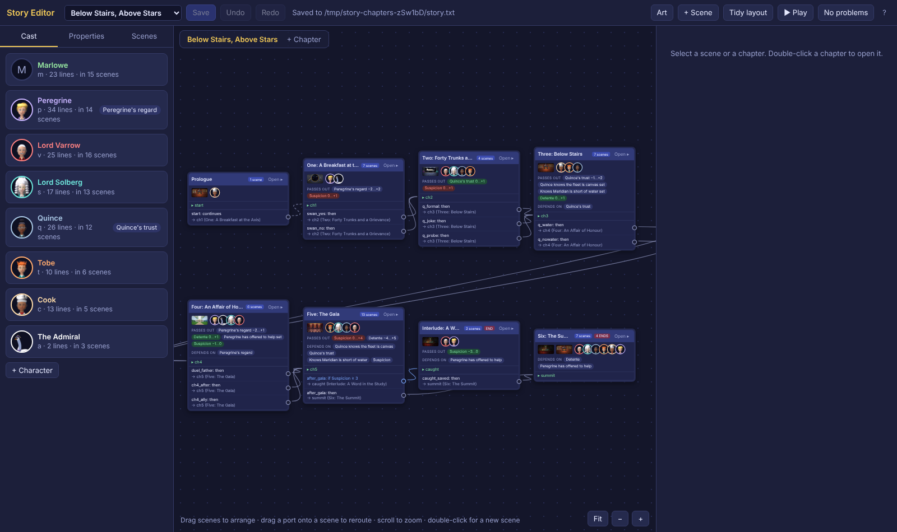

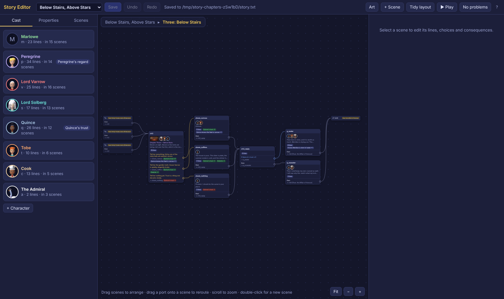

- **Chapters** keep a large story manageable. The main graph shows each
  chapter as one panel listing its ways in, its ways out, and what it *passes
  out* to the rest of the story: the range of change it can make to each
  property over every route through it (for example "Quince's trust −1…+2"),
  and the properties its conditions depend on. Double-click a panel to open
  the chapter as a graph of its own; scenes outside it that lead in or out
  appear as dashed portals you can click to follow. The bar at the top left
  leads back up. Edit a consequence inside and the panel outside updates.
- **The graph** shows every scene as a box. Gold lines are choices, blue are
  conditions, grey are jumps, and a dashed line means the scene simply
  continues into the next one. Drag scenes to arrange them; drag the round
  port at the end of a choice, condition or jump on to another scene to
  change where it leads, or on to empty space to make a new scene.
- **Consequences** are changes to a property (Detente +2, Suspicion +1).
  They appear as chips on the scene they happen in and beside every choice
  that leads there.
- **The panel on the right** edits the selected scene: its lines, choices,
  consequences, conditions, backgrounds and who is on screen. Drag a block by
  its grip to reorder it, or drop it on another scene in the graph to move it
  there.
- **Cast** holds each character's name, name colour, portrait and look (hair,
  skin, coat, age and so on, with a live preview), and the properties that
  belong to them. **Properties** lists every property, its starting value,
  whether it has an on-screen meter, and everywhere it is changed or tested.
  **Scenes** lists scenes in file order; drag to reorder.
- Problems are checked as you type by the same validator the game uses.
  **Play** and **Play from here** save and launch the game at that scene.
- Undo and redo work on everything; the first save of a session keeps the
  previous file as `story.txt.bak`.
- If the story file changes on disk while you have it open (another tab, an
  edit by hand), saving asks before replacing it.

### Working with chapters

- Put a scene in a chapter with the **Chapter** menu at the top of its panel,
  or drag it from the Scenes list on to a chapter panel. New scenes join the
  chapter you are in.
- **+ Chapter** (top left of the main graph) adds an empty one. For a story
  with none, **Chapters from chapter cards** groups the scenes automatically,
  starting a chapter at each chapter card.
- Drag a chapter's way out on to another chapter (or one of its ways in) to
  reroute the story between chapters without opening either.
- Dissolving a chapter returns its scenes to the main graph; nothing is
  deleted. Chapters are for organising: the game plays the same with or
  without them.
- In the story file a chapter is a `chapter Name | x y | note` line and each
  member scene carries `# @chapter Name` under its label.

### Several stories

The menu at the top of the editor switches between stories and makes,
duplicates or removes them. Every story is independent: its own file, cast,
properties and art.

- The main story is `assets/story.txt`. Others live in
  `stories/<name>/story.txt`.
- A story's title and subtitle (Scenes tab) appear on the game's title screen.
- Removing a story moves its folder to `stories/.removed/`; nothing is deleted.
- To play one: `cargo run --release -- --story stories/<name>/story.txt`, or
  use Play in the editor.

### Creating characters and places with Claude or Ollama

**Cast → ✦ Create with AI** designs a new character from a description, and
**Scenes → ✦ New place with AI** paints a new place. Either can ask Claude
(through the Claude API) or any model you run with
[Ollama](https://ollama.com), on this computer or another.

- **A character** comes back as one of the game's six portrait figures,
  recoloured and reshaped (skin, hair, eyes, coat, face width, jaw, age and
  so on), with a name, a name colour and a short note on who they are. Look
  at it, rename it if you like, and **Add to the cast**. The description it
  was made from is kept as that character's ComfyUI prompt, so the Art view
  can paint a proper portrait of them.
- **A place** comes back as a painting made of layers of simple shapes
  (bands of sky, polygons, soft haze, glowing lamps, stars) and marks made
  by hand (brush strokes, watercolour washes, pen hatching), drawn by the
  game's own renderer, so it works in the game, the editor, the Art view and
  the Godot export like the seven built-in places. Tick **Also build it as a
  3D room** and the model lays out a room to walk through as well (floor,
  walls, furniture, lamps), which opens in the World editor. **Add to the
  story** saves it, and it appears in every Background block's list.
- **Art styles.** Both dialogs offer a choice of style. For a place, the
  style decides how the model is told to paint and the surface the game
  gives the finished painting; for a character, it is the style of the
  portrait ComfyUI is asked to paint (the game's own portrait figure stays
  as it is). The same style words go into the place's ComfyUI prompt.

  | Style | How it is painted |
  |---|---|
  | Matte painting | Layered shapes, haze and glowing light: the game's own look. |
  | Oil painting (bristle brush) | Stroke by stroke with simulated bristle brushes, after [aibrush](https://github.com/neokrasav4ik/aibrush): each hair carries its own paint, which runs out along the stroke (dry brush), picks up the wet paint it passes over and leaves ridges that catch the light (impasto), on a linen weave. The model is told to work as aibrush advises a painter: plan the composition and values, a toned ground, block in with wide brushes at a low load, model the forms, soften edges with a clean brush, details, then thick accents last. |
  | Impressionist | Broken colour in short dabs of thick paint. |
  | Watercolour | Transparent washes that darken what is under them, pool at their edges and bloom when wet, on paper grain; the paper is left for the lights. |
  | Pen and ink | Outlines and hatching (cross-hatched for shadow) on warm paper, with a little wash. |
  | Pixel art | Big 4x4 pixels in a 20-colour dithered palette taken from the painting. |
  | Gouache poster | Flat opaque shapes reduced to nine colours, like a mid-century travel poster. |
  | Woodblock print | Flat inks, bold outlines and paper grain, in seven colours, after Japanese prints. |

  The brush engine is the game's own (`src/brush.rs`), a much smaller model
  than aibrush's, written for this renderer. It offers aibrush's nine brushes
  (flat, narrow flat, round, soft, dry, liner, fan, ragged, palette knife),
  with pressure along each stroke and a paint load from 0 (a clean brush
  that only blends) to 0.9 (impasto).
- A painting file can be looked at while you edit it by hand:
  `cargo run -- --render-painting stories/x/paintings/roof.json --out roof.png`
  (add `--style oil`, say, to see it in another style).
- A story's own places live beside it: `paintings/<name>.json` for the
  painting (plain JSON, easy to edit by hand) and `world/<name>.json` for the
  room. They travel with the story when it is exported, imported or copied.
  The game's own place names cannot be taken.
- Whatever the model sends is checked and cleaned by the game's rules
  before it is used: unknown shapes are left out, numbers are kept within
  what the renderer draws, ids are made unique.

Setting it up:

- **Claude:** start the editor with your API key in its environment:
  `ANTHROPIC_API_KEY=... cargo run --release -- --editor`. The key is only
  ever sent to the Claude API in a request header: it is not written to any
  file, shown on the page, or logged. The default model is
  `claude-opus-5-5`; type another model's id in the dialog to use it.
  `ANTHROPIC_BASE_URL` sends the requests somewhere else (a gateway).
  Requests are streamed and ask for JSON of a fixed shape. For the models
  that support it, server-side fallback is turned on, so a request the
  model declines can be finished by another model instead of failing.
  A refusal, a busy API (retried a few times) and a missing key are
  reported plainly in the dialog.
- **Ollama:** run Ollama and pull a model (`ollama pull qwen3:32b`, say);
  the dialog lists the models it has. `OLLAMA_HOST` points to it if it is
  not at `http://127.0.0.1:11434`. Larger models paint better places: a
  small model may return a sparse painting, and is worth a second try.

To try it with no key and no Ollama, `python3 tools/mock_ai_server.py`
runs a stand-in for both; point `ANTHROPIC_BASE_URL` and `OLLAMA_HOST` at
the address it prints.

### Art: sending assets through ComfyUI

The **Art** button opens a view of every background and every character
expression in the current story, and sends any of them through ComfyUI.

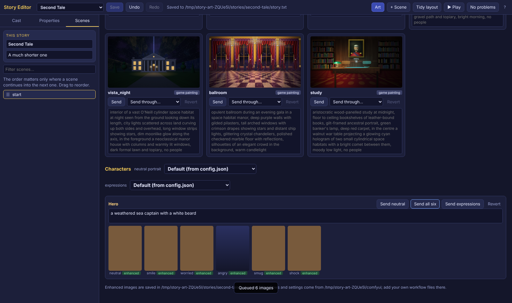

- Set the ComfyUI address at the top; the checkpoint and ControlNet lists are
  read from that server.
- Pick a workflow for backgrounds, for neutral portraits and for expressions,
  or send a single image "through" another workflow once. Six come built in:

  | Workflow | For | What it does |
  |---|---|---|
  | Faithful repaint | backgrounds | img2img from the game's painting, composition held by ControlNet |
  | Reimagine | backgrounds | painted from scratch; only the painting's outlines are kept |
  | Refine | backgrounds | a light second pass over the current image, no ControlNet |
  | Faithful portrait | neutral portraits | img2img + ControlNet, cut out with the sprite's own silhouette |
  | Reimagine portrait | neutral portraits | from scratch inside the sprite's outline |
  | Expression | the other five expressions | repaints only the face of the enhanced neutral, so the character stays the same person |

- Each background and character has a text prompt you can replace; a
  character whose look you have changed in the Cast tab will want one.
- Jobs queue up and run one at a time; results appear in place, with a
  click-to-compare against the game's own painting. **Revert** goes back to
  the painting (the file is set aside in `enhanced/.removed`).
- Results are saved beside the story, in its `enhanced/` folder
  (`assets/enhanced/` for the main story), which is where the game looks.
- Workflows are the JSON files in `comfyui/workflows/`. Add your own there:
  give it a `title`, a `kind` (`background`, `sprite` or `expression`) and
  the same `$placeholders` as the built-in ones, and it appears in the menus.

No image has been generated with these workflows on a real GPU; see
[comfyui/README.md](comfyui/README.md) for what was and was not verified, and
for the command-line runner that does the same job in bulk. To try the Art
view without ComfyUI, `python3 tools/mock_comfy_server.py` runs a stand-in
that returns placeholder images.

Options: `--port N`, `--no-browser`, `--story FILE` (the main story),
`--stories DIR`, `--comfy-dir DIR`. The editor listens on your own machine
only and refuses requests from other web pages.

## Schedules: who is where, and when

A story can keep a clock, and its characters can keep a day. Wherever the
story goes, whoever's schedule has them in that place at that time is
simply there, on stage, without the scene having to show them; when their
time comes they leave, and others arrive. Things that happen can pull them
away from it.

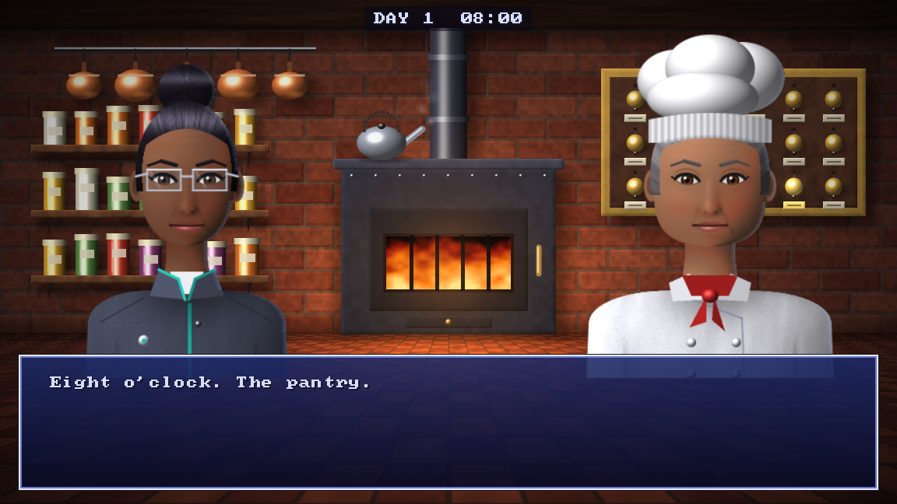

In the story file:

```
clock 08:00 | 5                                  the day starts at eight; a line takes five minutes

schedule q | 06:00 pantry | 08:20 dock | 12:00 pantry
schedule c | 05:00 pantry | 22:00 away           "away": nowhere to be seen
interrupt c | event fire | vista | flees the kitchen
interrupt q | alarm >= 2 | study | reports upstairs
```

- **The clock** moves as lines are spoken, and when a scene says so:
  `time 09:30` (forward to that time of day; tomorrow's if it has passed)
  and `pass 30` (minutes). It is shown at the top of the screen.
- **A schedule** is a list of times and places for one character; they are
  at the latest one that has come. Before the day's first entry they are
  where the night before left them.
- **An interrupt** overrides the schedule for as long as its condition
  holds, the first listed winning: an event that a scene starts and ends
  (`event fire` ... `event fire off`), a property passing a mark, or the
  clock (`clock >= 22:00`). When it no longer holds they go back to their
  day.
- **Scenes can ask**: conditions on `if` lines and choices can test
  `@q` (is Quince here, where the story is?), `@q.study` (is Quince in the
  study?), `clock`, `day` and `event.fire`, so a choice can be offered only
  while someone is in the room:

  ```
  choice
  - [@c == 1] Ask Cook what happened => asked
  - Say nothing => quiet
  ```

People the scene itself shows or hides are left to the scene: a `show` puts
them where it says, and someone sent off with `hide` stays off until the
story moves to another place. Arrivals and departures while you are in a
place are announced; whoever is already there when you arrive is just
there. In a 3D place, and in VR, they stand in the room like anyone else.

In the editor, a character's card in **Cast** has their Schedule (times,
places, a note on what they are doing) and their Interruptions, and the top
of Cast shows the whole household's day as a table. The clock is under
**Scenes > This story**; **Time**, **Time passes** and **Event** blocks go in
scenes; conditions offer the time, events and "... is here" beside the
properties.

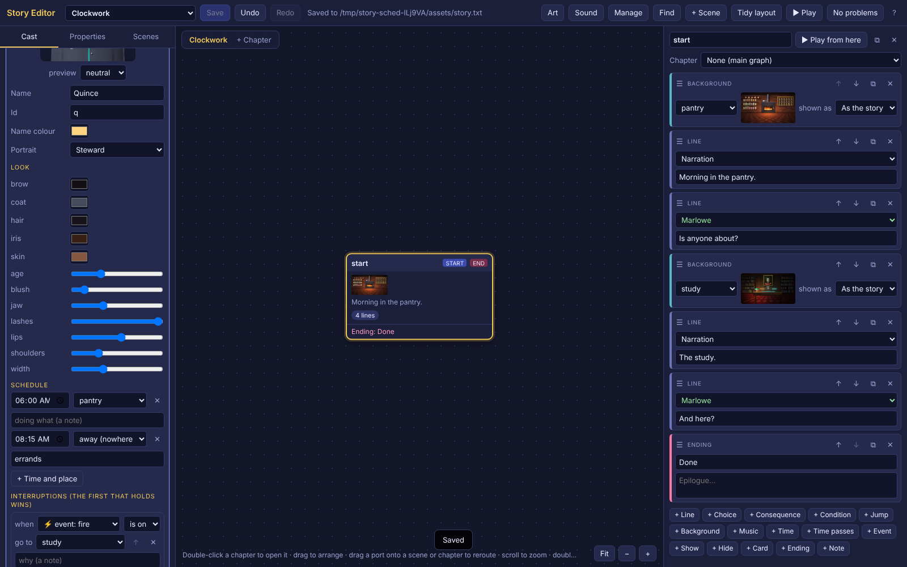

`assets/example_schedule.txt` is a small story that uses all of it:

```bash
cargo run --release -- --story assets/example_schedule.txt
```

Played without a window (`--autoplay 0`) the game prints who came and went:
`schedule: 08:00 q is in pantry; 08:20 q leaves pantry; ...`.

## What characters have: attributes, items, information

Besides the story's own properties, every character can have things of
three kinds, and scenes can move them between characters:

| Kind | Is | Example |
|---|---|---|
| **attribute** | a number about a person | nerve, rank, standing with the Admiral |
| **item** | how many of something they carry (never fewer than none) | coins, the cellar key |
| **information** | something they know, or do not | that the fleet is canvas |

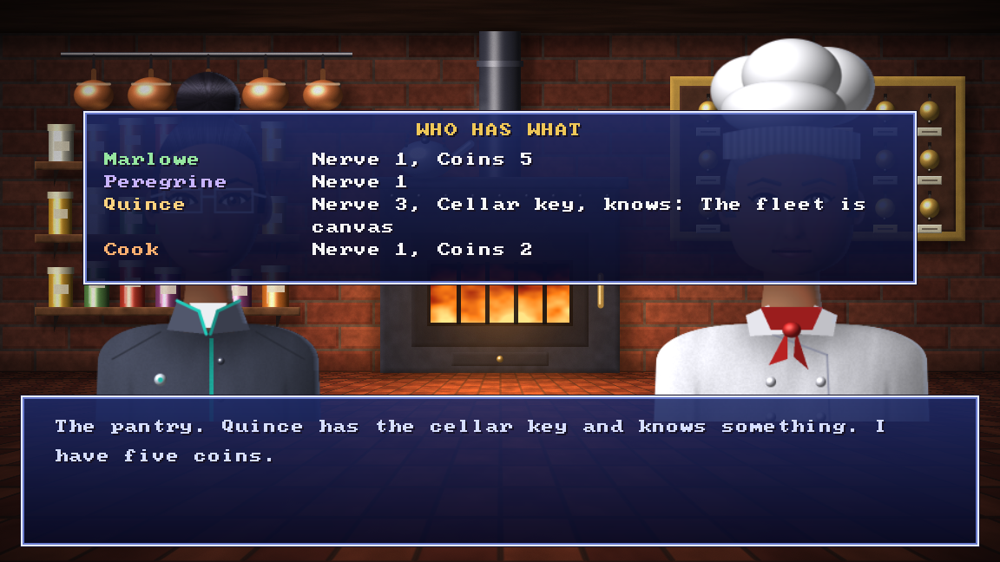

In the story file:

```
attribute nerve | Nerve | 1                    everyone starts with 1
item coin | Coins
item key | Cellar key | 0 | | opens the wine cellar
info canvas | The fleet is canvas
info recipe | Cook's secret recipe | 0 | hidden      never shown to the player
holds m | coin 5
holds q | key | canvas | nerve 3               what one character starts with
```

and in scenes:

| Line | Does |
|---|---|
| `give m c coin 2` | **hands over**: Marlowe loses two coins, Cook gains them. Nobody gives more than they have; information given away is forgotten by the giver. |
| `copy q m canvas` | **duplicates**: Quince tells Marlowe, and both know it. For an item the other gets their own (`copy q p key 2`); for an attribute the other is brought to the same level. |
| `trade m q coin 3 for key 1` | **an exchange**, which happens only if each has what they offer; otherwise nothing changes hands. |
| `grant p coin 1` | one character gains (or with a minus, loses) something from nowhere. |

Conditions on `if` lines, choices and schedule interrupts ask after them as
`who.thing`:

```
choice
- [m.coin >= 3] Buy the key from Quince => buy
- [q.canvas == 1] Ask what Quince knows => ask
```

In the game, changes are announced ("Marlowe: Coins -3", "Marlowe learns:
The fleet is canvas") and the **I** key shows who has what. Things marked
`hidden` are tracked all the same but never shown.

In the editor they are under **Properties > What characters have**: define
attributes, items and information there, and fill in the table of who
starts with what (also on each character's card in Cast). **Give**,
**Copy / tell**, **Gain or lose** and **Trade** blocks go in scenes, and a
condition can be set to "what someone has".

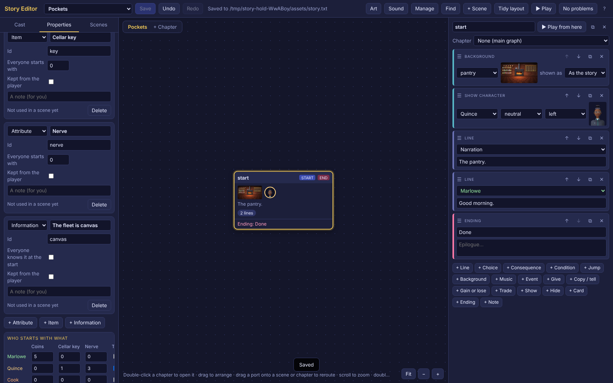

`assets/example_holdings.txt` is a small story that uses all of it. Played
without a window the game prints what changed hands:
`exchanges: m coin -3; q coin +3; q key -1; m key +1; ...`.

## Walking through the story in 3D

A story's places can be shown as paintings, or as a 3D world you walk
through, drawn by the [Bevy](https://bevyengine.org) engine. The story is
the same either way: the same lines, choices and properties, and the same
text and meters on screen. In a 3D place the painting gives way to a built
room, the cast stand in it as upright cut-outs of their portraits that turn
to face you, and you are free to wander about while they talk.

| | |
|---|---|
| 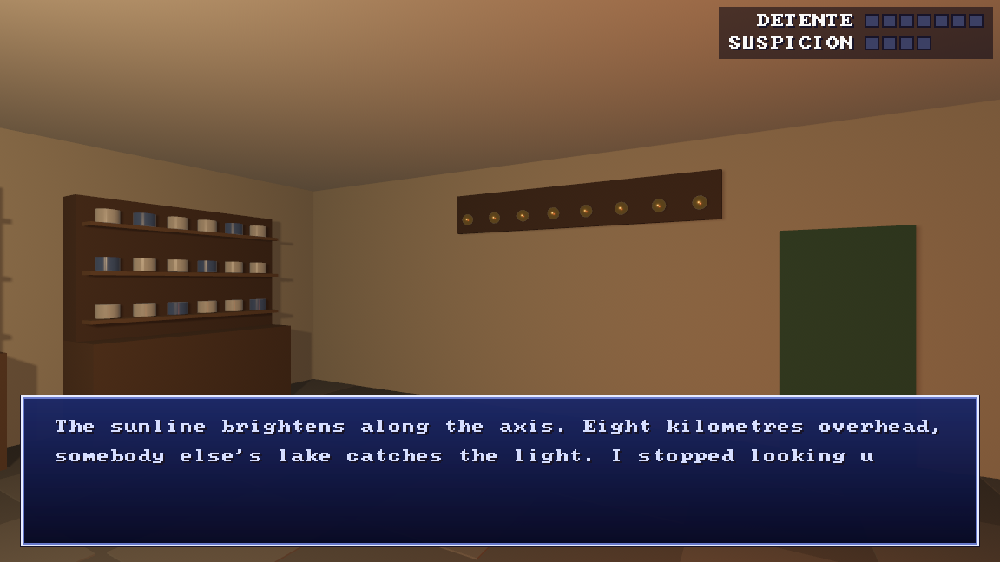 | 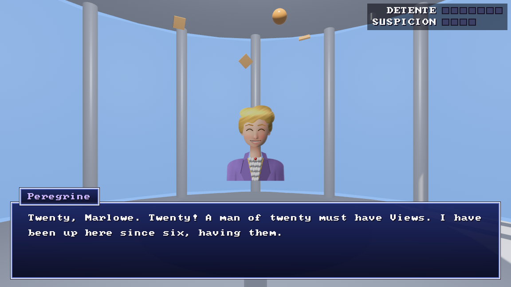 |
| 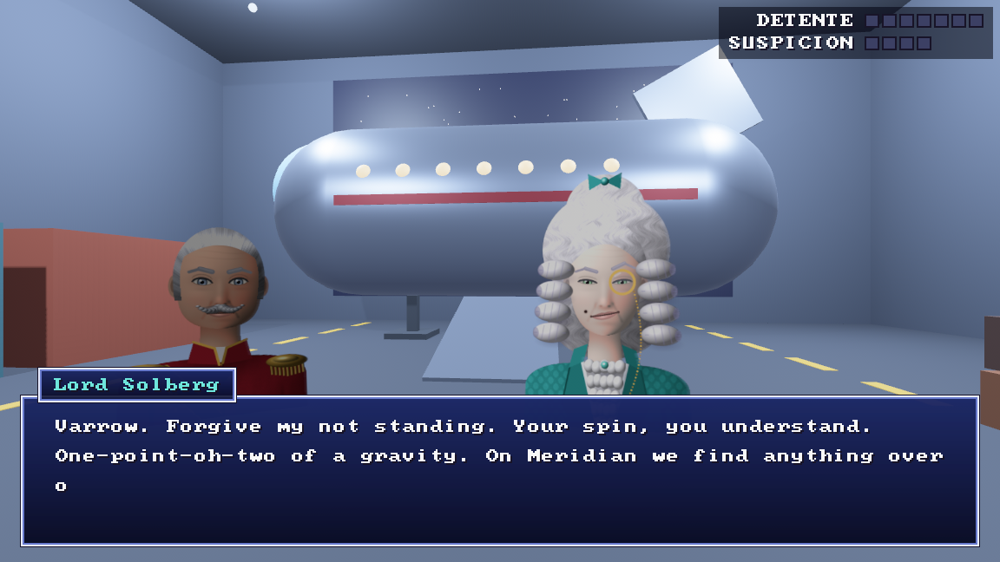 | 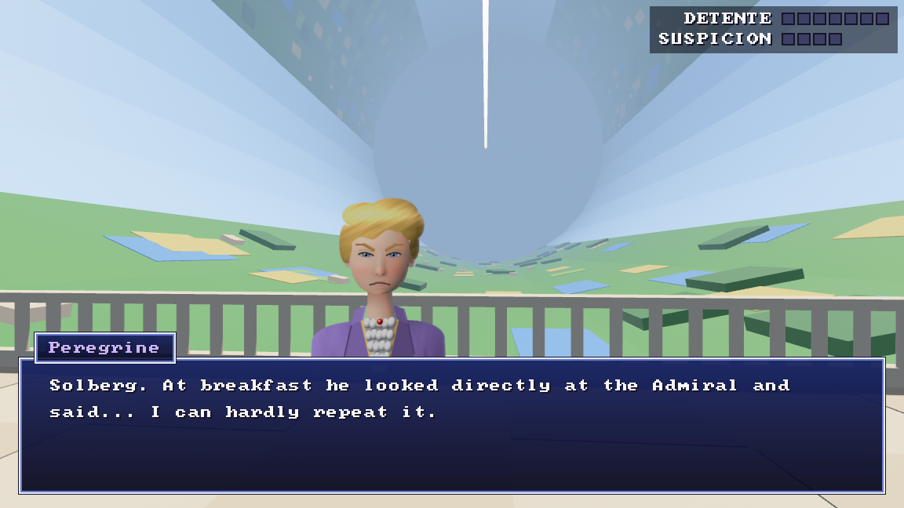 |
| 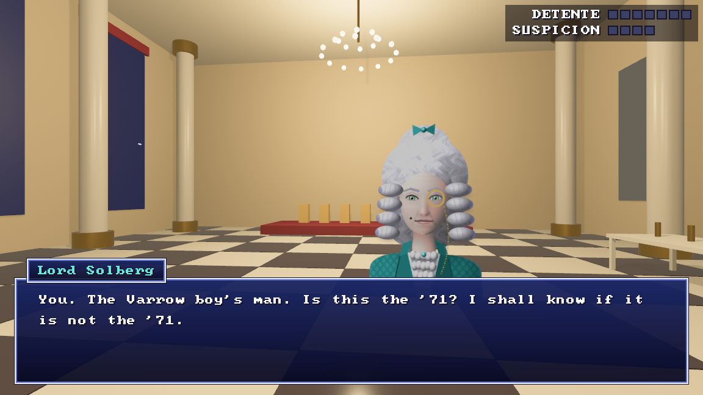 | 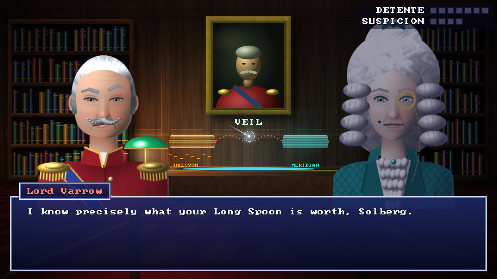 |

The choice is made per story, and can be overridden per place:

```
render 3d            every place is a 3D world ...
render study 2d      ... except the study, which stays a painting
```

or, the other way round, a painted story with `render vista 3d` for a
single place. In the editor it is under **Scenes > This story > Places are
shown as**, with a place-by-place list below it, and on every Background
block ("shown as"). Scenes in 3D places carry a "3D" mark on the graph.
(The last picture above is the study left as a painting while the rest of
that story is in 3D: both are shown in the one window.)

The engine is a large dependency (several minutes to build the first time),
so it is an opt-in feature:

```bash
cargo run --release --features world3d
```

| Key | In a 3D place |
|---|---|
| W A S D | walk (Shift to hurry) |
| Left / Right, or Q / E | turn |
| hold the right mouse button | look around |
| Up / Down | pick a choice |
| hold Tab | hide the text to look around |

Everything else is as in the table under Controls. A build without the
feature plays the same stories and shows the paintings instead, saying so
once; `--2d` asks for that on purpose. All seven places the game paints
have a 3D build, each a description in `assets/places/` of simple shapes,
lights and air; a story can replace any of them with its own (next
section). Enhanced portraits from ComfyUI are used for cut-outs in 3D too.

To check a build on a machine with no screen or graphics card:

```bash
cargo build --features world3d && tools/world3d_shots.sh /tmp/shots
```

takes a picture in each place (under `xvfb-run` with Mesa's software Vulkan,
`mesa-vulkan-drivers`; that is how the pictures above were made). It has
only been run that way: on a software renderer, not yet on a real graphics
card.

## 3D environments and 3D characters

**Places are data.** A 3D place is a JSON file: its parts (boxes, cylinders,
spheres, capsules, or glTF models), its lights, its air (sky, ambient light,
fog), where you start, where the cast's left, centre and right stand, the
floor you may walk on and what is in the way. The game's own seven are in
`assets/places/`. A story keeps its own versions in a `world` folder beside
its story file (`world/<place>.json`), with model files in `world/models/`;
they travel with an exported bundle.

**The World view** in the story editor is a 3D editor for them:

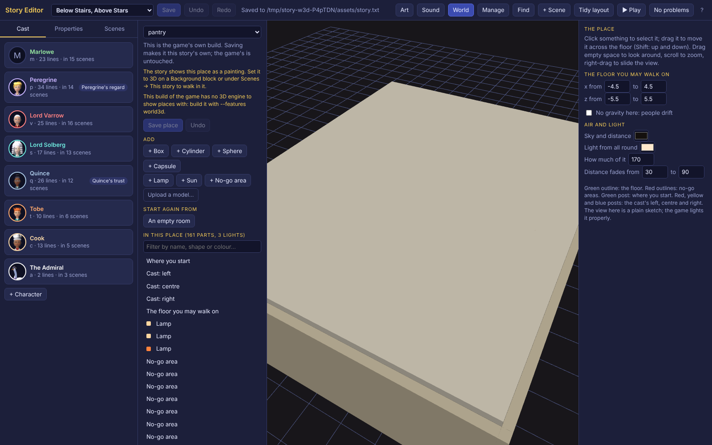

- Pick a place; it opens as this story's version, or the game's own.
- Add boxes, cylinders, spheres, capsules, lamps, a sun, no-go areas, or a
  model file (`.glb` / `.gltf`, uploaded or already in the story).
- Click to select; drag to move across the floor (Shift: up and down); the
  panel on the right sets position, size, turn, colour, glow, roughness,
  metal, whether it is solid and whether it casts a shadow.
- The green post is where you start, the red, yellow and blue posts where
  the cast stand; the green outline is the walkable floor.
- Drag empty space to look around, scroll to zoom, right-drag to slide.
  Ctrl+Z undoes, Ctrl+S saves, Delete removes the selected part. A ceiling
  or wall standing between you and the middle of the room is left out of
  the view so that you can see in ("See in", on by default).
- "An empty room" starts from nothing; "The game's own" goes back to the
  built-in place (this story's version is set aside, not deleted).

The view there is a plain sketch (flat light, model files shown as
placeholder boxes); the game lights the same description with shadows, lamps
and fog:

| | |
|---|---|
| 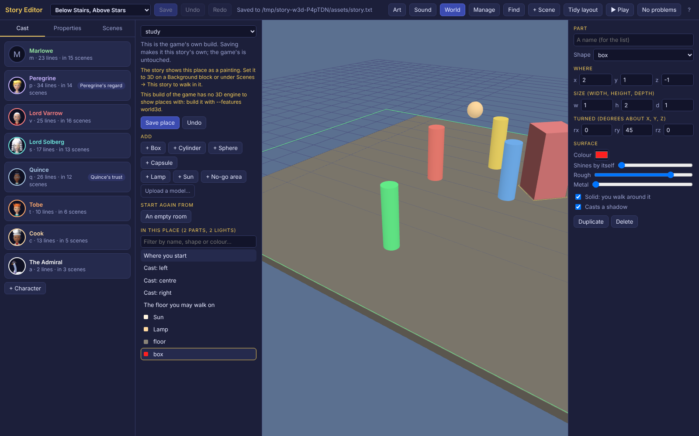 | 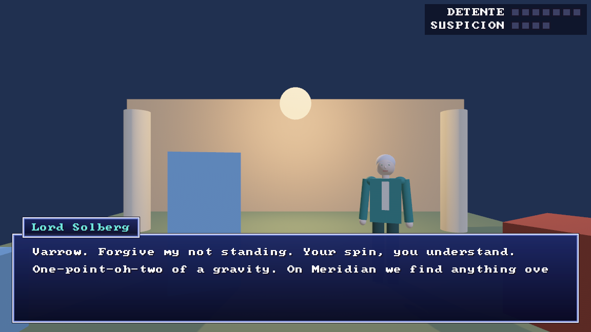 |

**Characters in 3D** can be, each to their own (Cast > "In a 3D place", or a
`model` line in the story file):

| | |
|---|---|
| a cut-out of their portrait | the default; turns to face you |
| `model p \| figure` | a 3D figure built from their look: skin, hair and coat colours, with brows, eyes and mouth that follow their expression |
| `model v \| varrow.glb \| 1.2` | a glTF model from `world/models/`, shown at 1.2 times its made size |

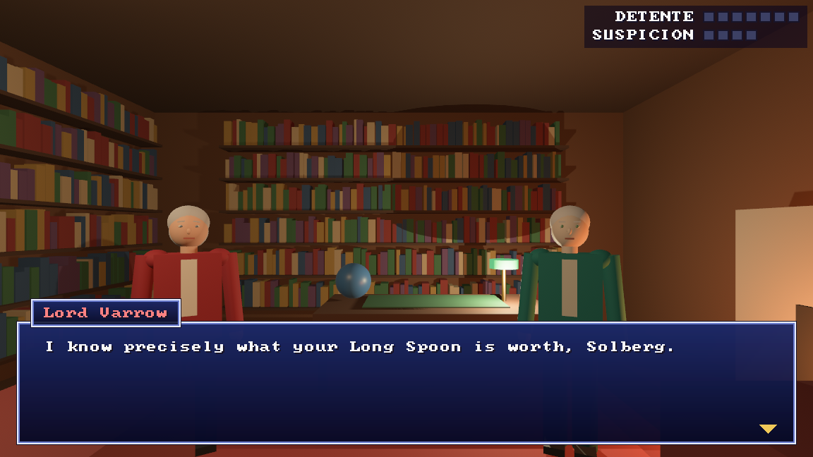

A model must be one file: a `.glb`, or a `.gltf` with everything embedded
(one that keeps its mesh or textures in other files is refused, with the
advice to save it as `.glb`). If a character's model file is missing they
appear as their cut-out instead. Model support is limited to what the
engine's glTF loader shows as a still scene: meshes and materials (with PNG or JPEG textures). Animations in a
file are not played, and a model keeps one face whatever the character's
expression. It has been tried with a small generated model
(`node tools/make_glb.js out.glb`), not with a rigged character from a
modelling package.

## In a VR headset

The 3D world can be walked through in a headset, through
[OpenXR](https://www.khronos.org/openxr/) (so SteamVR, Monado, the Meta and
Windows Mixed Reality runtimes and the like), using the Bevy community's
OpenXR plugin:

```bash
cargo run --release --features vr -- --vr
```

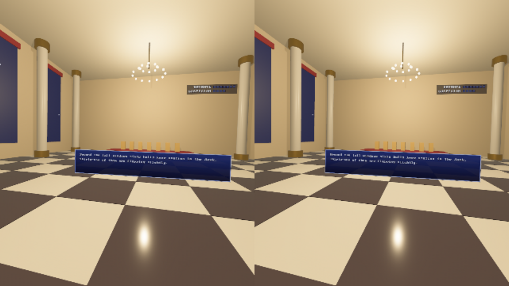

You stand where the player stands in each place, at your own height, and
are free to look and lean as the headset tracks you. The story's text,
choices and meters hang in the air about two metres ahead as a panel; it
stays put while you look around and comes round in front of you once you
have clearly turned away. Near a wall it moves closer rather than into it.

| Control | Does |
|---|---|
| left stick (on Vive wands: press the left trackpad) | walk, in the direction you are looking |
| right stick, sideways | turn in 30 degree steps |
| right stick, up / down | pick a choice |
| either trigger | advance, confirm |

Bindings are suggested for Oculus Touch, Valve Index, HTC Vive and Windows
Mixed Reality controllers, and for OpenXR's simple controller (advance
only). The keyboard and mouse keep working, and the window on the desktop
shows the ordinary view. Comfort choices: turning is in steps, walking is at
a steady pace, and the gentle swaying of the zero-gravity room is left out.
Real steps in your room move you through the place too and stop at its
walls, and turning pivots about where you stand, not about the middle of
your play area.

Places that a story leaves as paintings, and the title screen and chapter
cards, are shown on a large screen in the dark, so any story can be played
this way, including one with no 3D places at all:

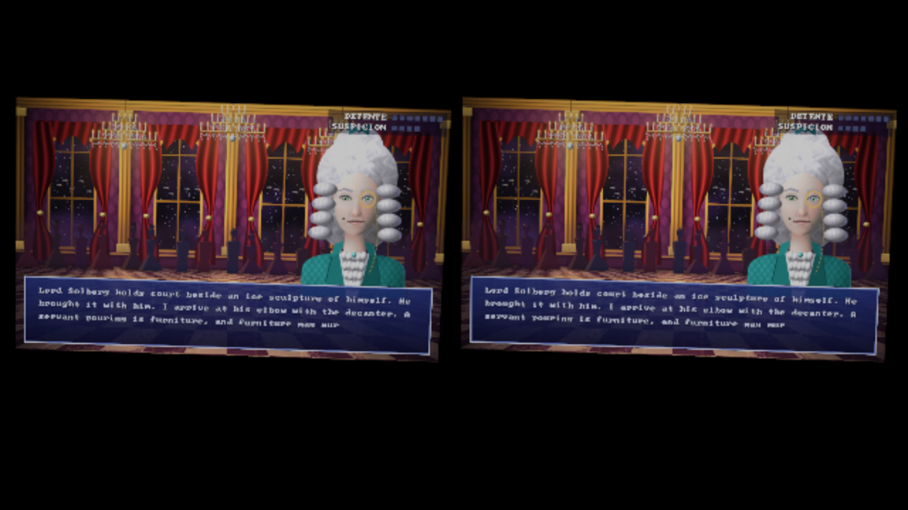

If no OpenXR runtime or headset is found, `--vr` says so and carries on as
the desktop 3D game. On Linux the OpenXR loader must be findable as
`libopenxr_loader.so` (the `libopenxr-dev` package provides that name).

**How far this is tested.** No headset was available where this was
written. It has been run against the Monado runtime's *simulated* headset
on a software renderer (`tools/vr_check.sh` repeats that, and made the
pictures above): the OpenXR session starts, both eyes are rendered, the
text panel is drawn, the controller actions are accepted by the runtime.
Nothing has been tried on real hardware: controller bindings, the feel of
walking and turning, the panel's size and height, and performance at a
headset's frame rate are all unverified until someone puts one on.

## Managing the library

**Manage** in the editor's top bar is the place to look after stories:

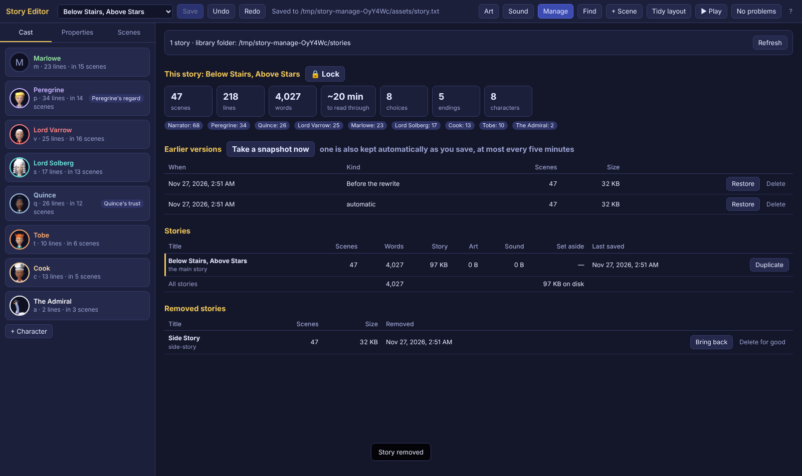

- **Figures** for the open story: scenes, lines, words, a rough reading
  time, choices, endings and how many lines each speaker has.
- **Earlier versions.** Whenever a change is saved, the version before it is
  kept in `.history/` beside the story (at most one every five minutes, the
  newest 30; always when a save replaces the story with another version). "Take a snapshot now" keeps a named one that is never thinned
  out. Restore shows a version in the editor as an unsaved, undoable change;
  nothing on disk changes until you save.
- **Lock.** A locked story cannot be saved over or removed until it is
  unlocked, and neither can its pictures, recordings, voice settings or
  history (a `story.txt.locked` file beside it; the game is not affected).
- **Stories.** Every story with its word count, its size on disk split into
  story, art and sound, and when it was last saved; open, duplicate or
  remove from here. "Free ..." deletes what was only set aside: replaced
  pictures and recordings, and the session's backup copy.
- **Removed stories** can be brought back, or deleted for good.

Two more conveniences:

- **Find** (Ctrl+F) searches all dialogue, choices, cards, endings and
  notes; a result opens its line, and "Replace all" is one undoable step.
- **Drafts.** Unsaved work is kept in the browser as you type. If the page
  is closed or crashes, the editor offers it back the next time that story
  is opened in the same browser.


The story menu's **Files** group moves stories in and out of the editor as
single files:

| Menu entry | File | Holds |
|---|---|---|
| Export this story | `<name>.story.json` | the story (cast, properties, tracks, chapters, scenes) and its art and sound choices |
| Export with its art and sound | `<name>.bundle.json` | the same, plus the enhanced pictures, recordings and voice samples |
| Export as a story text file | `<name>.story.txt` | the story in the plain text format the game reads |
| Import a story from a file | any of the three, or a bare story in JSON | |

An import always becomes a **new** story in the library; nothing already
there is changed. Unsaved changes are saved before an export, so the file
is what is on screen. The JSON looks like this:

```json
{
  "format": "below-stairs-story",
  "version": 1,
  "story": { "title": "...", "characters": [], "vars": [], "tracks": [], "chapters": [], "scenes": [] },
  "prefs": { "prompts": {}, "workflows": {}, "voices": {} },
  "files": { "enhanced/bg_vista.png": "<base64>", "audio/music_estate.flac": "<base64>" }
}
```

`story` is exactly what the editor edits, so the file can be written or
changed by other tools; a block is `{"t": "say", "who": "p", "text": "..."}`
and so on. `files` is optional. On import only pictures (`enhanced/*.png`),
recordings (`audio/*`) and voice samples (`audio/samples/*`) with plain file
names are accepted; anything else in `files` is left out and reported.
Pictures larger than 8192 pixels a side are refused, and one file can carry
up to 512 MB; a story with more art and sound than that is exported alone
and its `enhanced` and `audio` folders copied by hand. A cut-off or damaged
`.json` file is refused rather than guessed at.
A story file from elsewhere is as trustworthy as its sender: it cannot write
outside its own new folder, but read it before you play it.


The game plays whatever recordings it finds beside the story, in `audio/`:

| File | Played |
|---|---|
| `music_<track>.<ext>` | looped, from a `music <track>` line until the next one (`music off` stops it) |
| `voice_<who>_<hash>.<ext>` | when that speaker says exactly those words (`n` is the narrator) |

FLAC, MP3, Ogg Vorbis and WAV are read. Anything missing is simply silent,
so the game works with none, some or all of it recorded. A line's file name
is made from its words: reword the line and it needs recording again.

The files are made in the editor's **Sound** view, through ComfyUI:

- **Music.** Add a track, describe it ("slow tense low strings, a ticking
  pulse"), set its length and press Generate. Start it in a scene with a
  **Music** block. In the story file: `track id | Title | seconds | prompt`
  and `music id`.
- **Voices.** Each speaker gets a voice: a stock voice picked from a list, or
  one cloned from a short sample recording you upload (5 to 15 seconds of
  clear speech; some workflows also want the words spoken in it). "Record
  missing lines" sends every unrecorded line of that speaker; single lines can
  be redone, played back and removed. Choices are kept with the story in
  `art.json`, samples in `audio/samples/`.
- "Tidy up old recordings" sets aside the files of lines that were reworded
  or cut (into `audio/.removed`).

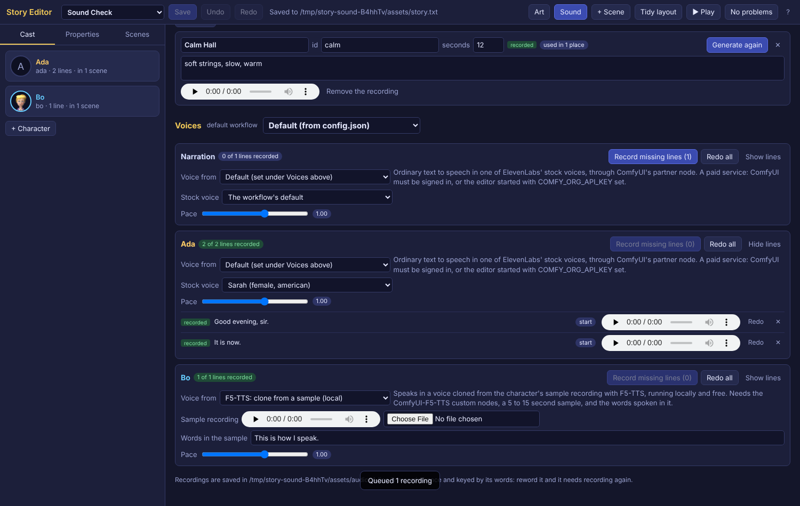

Which workflow does the work is selectable, per kind and per speaker:

| Workflow | Needs |
|---|---|
| `music_stable_audio.json` | Stable Audio Open checkpoint and its T5 text encoder (local) |
| `music_ace_step.json` | ACE-Step checkpoint (local) |
| `voice_elevenlabs.json` | stock voices; ComfyUI's ElevenLabs partner node, a **paid** service |
| `voice_elevenlabs_clone.json` | a sample; the same paid service |
| `voice_f5_clone.json` | a sample and its transcript; the ComfyUI-F5-TTS custom node (local) |

Partner nodes need a Comfy account key. Set it in the environment when
starting the editor (`COMFY_ORG_API_KEY=... cargo run -- --editor`); it is
sent to your ComfyUI server with those jobs and never written to a file or
shown in the page. See [`comfyui/README.md`](comfyui/README.md) for the
details and for what has and has not been tried against a real server.

## Graphics

All artwork is procedural: there are no image files in the game. Each scene
is shaded per pixel with lit materials, perspective floors, soft shadows and
a small animated overlay (firelight, drifting breakfast, the hologram). The
six human characters come from one parameterised portrait renderer and have
six expressions each.

### Enhancing the art with ComfyUI

The paintings can be exported as guide images and repainted by a diffusion
model through ComfyUI, with the game's art holding the composition (img2img
plus ControlNet). See [comfyui/README.md](comfyui/README.md). In short:

```bash
python3 comfyui/enhance.py export
```

```bash
python3 comfyui/enhance.py run
```

The results go to `assets/enhanced/` as `bg_<name>.png` and
`spr_<who>_<expr>.png`. The game loads whichever of those exist in place of
its own painting (any resolution; sprites need transparency) and falls back
to the procedural version for the rest. `--procedural` ignores them,
`--art-dir DIR` or `$BELOW_STAIRS_ART` loads them from elsewhere. You can
drop hand-painted replacements there too.

## How it is built

- `src/gfx.rs` - software renderer: ARGB canvas, anti-aliased primitives,
  alpha compositing, noise, blur, resampling, PNG I/O, bitmap font.
- `src/art/` - the artwork: `paint.rs` (shading toolkit), one module per
  scene, `people.rs` and `swan.rs` for the cast, and `mod.rs` (registry,
  enhanced-art loader, guide export).
- `src/script.rs` - the story: document model (text and JSON), validator,
  compiler and virtual machine.
- `src/editor.rs`, `src/editor.html` - the story editor: a small local web
  server (story library, previews) and the page it serves.
- `src/comfy.rs` - the editor's ComfyUI client: workflow filling and
  checking, uploads, and the job queue.
- `src/game.rs` - title screen, dialogue, choices, HUD, save/load.
- `assets/story.txt` - the whole story, cast and properties, in a small
  line-based language documented at the top of the file. Edit it by hand or
  with the editor; the game reads it at start-up (`--story FILE` for another,
  `--start LABEL` to begin at a scene).
- `comfyui/` - the enhancement suite: workflows, runner, tests.

## Testing

```bash
cargo test
```

The tests validate the story, play every possible combination of choices to
check that each one reaches an ending and that all five endings are
reachable, and check that the story file survives a round trip through the
editor's formats unchanged.

The editor has a browser test (needs Node with Playwright):

```bash
cargo build && node tools/editor_e2e.js
```

```bash
cargo build && node tools/editor_sound_e2e.js
```

```bash
cargo build && node tools/editor_io_e2e.js
```

```bash
cargo build && node tools/editor_manage_e2e.js
```

```bash
cargo build && node tools/editor_world_e2e.js
```

```bash
cargo build && node tools/editor_schedule_e2e.js
```

```bash
cargo build && node tools/editor_holdings_e2e.js
```

```bash
cargo build && node tools/editor_ai_e2e.js
```

```bash
cargo build && node tools/editor_world3d_e2e.js
```

The 3D world has its own unit tests (`cargo test --features world3d`) and
the picture script described above.

```bash
cargo build && node tools/editor_art_e2e.js
```

```bash
cargo build && node tools/editor_chapters_e2e.js
```

The second covers the story library and the Art view, against a mock ComfyUI
server (also needs Python 3); the third covers chapters.

The ComfyUI suite has its own tests (no network or GPU needed):

```bash
python3 -m unittest discover comfyui/tests
```

A playthrough can also be run with no window, choosing the listed option at
each choice and writing screenshots:

```bash
cargo run --release -- --autoplay 0,0,1,0,0,2,3 --shots shots
```
