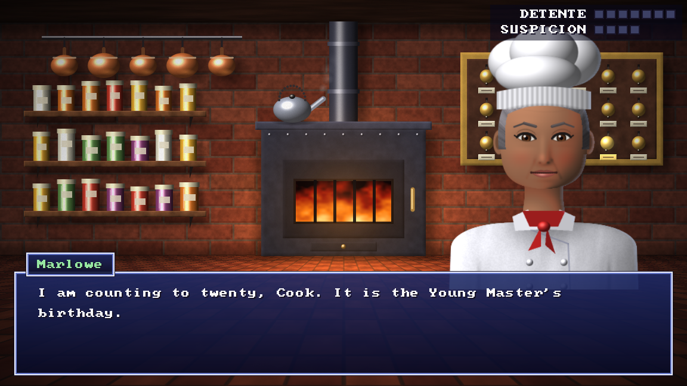
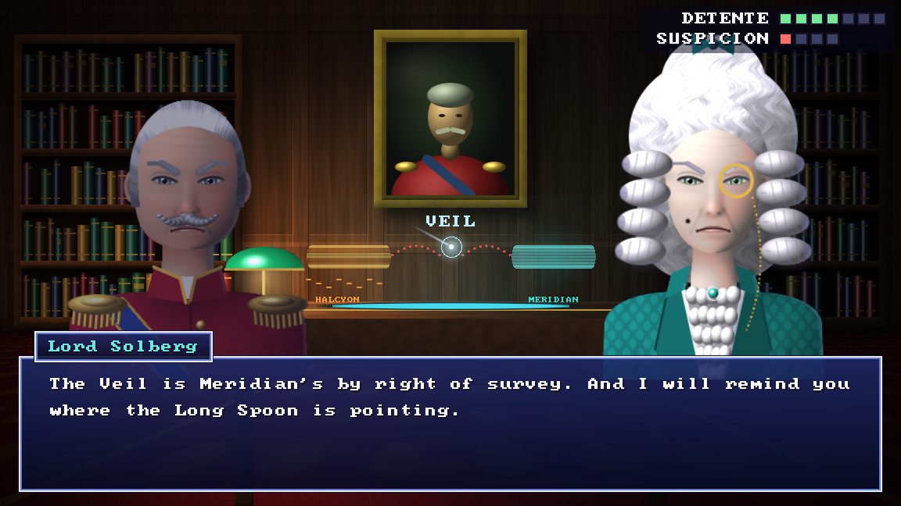

# Below Stairs, Above Stars

A sci-fi visual novel written in Rust, with every image painted in code.

You are Marlowe, head of household to the Honourable Peregrine Varrow, heir to
the Thistlemere estate on the O'Neill cylinder Halcyon Reach. He turns twenty
tomorrow. Lord Solberg has arrived from Meridian Spindle with forty trunks, his
own bottled air and an ultimatum, and both houses have their fists up over a
comet.

Your job is to survive the heir's Views (weightless soup, a swan with a naval
commission, a duel over the word "goose") while working with Lord Solberg's
servants to stop the war: letting the right thing be overheard by the right
lord. Tell a lord what his rival *needs* and he starts naming a price. Tell him
where his rival is *weak* and he reaches for a weapon.

Six chapters, five endings.

| | |
|---|---|
|  |  |
|  |  |
|  |  |

## Running

```bash
cargo run --release
```

Requires a Rust toolchain. On Linux the window uses X11 (`libx11-dev` or your
distribution's equivalent); Windows and macOS need nothing extra.

The game renders at 1152x648. The window is resizable; `--window 800x450`
sets its starting size.

## Controls

| Key | Action |
|---|---|
| Enter / Space / Z / left click | advance text, confirm |
| Up / Down (or W / S), mouse | pick a choice |
| Ctrl (hold) | skip text |
| F5 / F9 | save / load (one slot, `below_stairs.sav`) |
| Esc | back to title; quit from title |

The two meters top right are **Detente** (how close the lords are to a deal)
and **Suspicion** (how close you are to the algae vats).

## Graphics

All artwork is procedural: there are no image files in the game. Each scene
is shaded per pixel with lit materials, perspective floors, soft shadows and
a small animated overlay (firelight, drifting breakfast, the hologram). The
six human characters come from one parameterised portrait renderer and have
six expressions each.

### Enhancing the art with ComfyUI

The paintings can be exported as guide images and repainted by a diffusion
model through ComfyUI, with the game's art holding the composition (img2img
plus ControlNet). See [comfyui/README.md](comfyui/README.md). In short:

```bash
python3 comfyui/enhance.py export
```

```bash
python3 comfyui/enhance.py run
```

The results go to `assets/enhanced/` as `bg_<name>.png` and
`spr_<who>_<expr>.png`. The game loads whichever of those exist in place of
its own painting (any resolution; sprites need transparency) and falls back
to the procedural version for the rest. `--procedural` ignores them,
`--art-dir DIR` or `$BELOW_STAIRS_ART` loads them from elsewhere. You can
drop hand-painted replacements there too.

## How it is built

- `src/gfx.rs` - software renderer: ARGB canvas, anti-aliased primitives,
  alpha compositing, noise, blur, resampling, PNG I/O, bitmap font.
- `src/art/` - the artwork: `paint.rs` (shading toolkit), one module per
  scene, `people.rs` and `swan.rs` for the cast, and `mod.rs` (registry,
  enhanced-art loader, guide export).
- `src/script.rs` - parser and virtual machine for the story script.
- `src/game.rs` - title screen, dialogue, choices, HUD, save/load.
- `assets/story.txt` - the whole story, in a small line-based script language
  documented at the top of the file. Edit it and rebuild to change the game.
- `comfyui/` - the enhancement suite: workflows, runner, tests.

## Testing

```bash
cargo test
```

The tests validate every label, speaker, sprite and background referenced by
the story, then play every possible combination of choices to check that each
one reaches an ending and that all five endings are reachable.

The ComfyUI suite has its own tests (no network or GPU needed):

```bash
python3 -m unittest discover comfyui/tests
```

A playthrough can also be run with no window, choosing the listed option at
each choice and writing screenshots:

```bash
cargo run --release -- --autoplay 0,0,1,0,0,2,3 --shots shots
```
